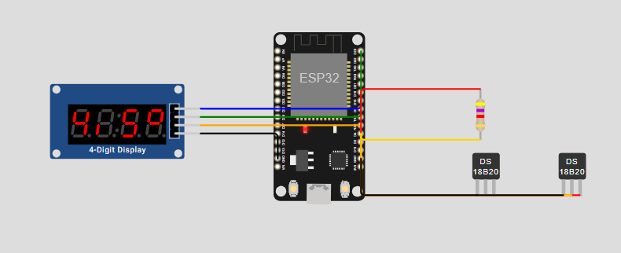

# Kühlschrank-Monitor

*[English version](README.md)*

ESP32 mit zwei DS18B20-Fühlern und einer 4-stelligen 7-Segment-Anzeige (TM1637).
Teile und Verkabelung: [partlist.md](partlist.md). **Bebilderte Bauanleitung:** [Deutsch](https://samba09.github.io/fridgeMonitor/anleitung.html) · [English](https://samba09.github.io/fridgeMonitor/guide.html) (öffnet im Browser, kein Account nötig).

## Was die Firmware macht

- **Anzeige:** Die beiden Fühler werden im Wechsel alle 3 s angezeigt, in ganzen Grad (`-18°`, ` 12°`); von 0,0 bis 9,9 °C mit einer Nachkommastelle (`4,5°`), das untere linke Segment dient als Komma, weil die Anzeige keine Dezimalpunkte hat. `----` bedeutet, dass der Fühler keine Werte liefert.
- **Eigenes WLAN (Hotspot) zur Einrichtung:** Das Netz heißt **`Kuehlschrank`**, das Standard-Passwort ist **`kuehlschrank`** (auf der Webseite änderbar). Nach dem Verbinden öffnet sich die Seite meist von selbst, sonst im Browser **http://192.168.4.1** aufrufen.
- **Webseite:** Aktuelle Temperaturen und ein 24-Stunden-Verlauf pro Fühler (1 Wert pro Minute) mit Min, Max und Durchschnitt. Außerdem Namen, Helligkeit, Fühler tauschen, WLAN und Firmware-Update.
- **Heim-WLAN (optional):** Kann auf der Webseite eingetragen werden. Dann ist die Seite im Heimnetz erreichbar (`http://kuehlschrank.local` oder die IP, die die Anzeige zeigt), und die Uhrzeit kommt aus dem Internet. Ohne Internet übernimmt der ESP die Uhrzeit vom Handy, sobald die Seite geöffnet wird.
- **Hotspot nur zur Einrichtung (Standard):** Ist das Heim-WLAN seit einer Minute verbunden und kein Handy mehr im Hotspot, geht der Hotspot aus. Ist das Heim-WLAN länger als 2 Minuten weg, geht er von selbst wieder an. Auf der Webseite auf „immer an“ umstellbar.
- **Fühler-Zuordnung:** Neue Fühler werden automatisch erkannt. Ein Fühler unter −5 °C heißt automatisch „Gefrierfach“, sonst „Kühlschrank“. Die Namen lassen sich auf der Webseite ändern.
- **BOOT-Taste kurz drücken:** Die Anzeige zeigt die IP-Adresse (`AP` = Hotspot-Adresse, `IP` = Adresse im Heim-WLAN).
- **Werksreset:** BOOT-Taste 10 s halten (die Anzeige zählt `rES7` … `rES1` herunter) oder Knopf auf der Webseite. Löscht Heim-WLAN, Hotspot-Passwort, Fühler-Namen und Helligkeit.
- **Einschränkung:** Der Verlauf liegt nur im RAM und ist nach einem Stromausfall weg.

## Flashen (einmalig per USB)

Die fertige Firmware gibt es unter [Releases](https://github.com/samba09/fridgeMonitor/releases/latest): `kuehlschrank-full.bin` zum ersten Flashen, `kuehlschrank-update.bin` für Updates über die Webseite. Wer selbst baut, findet beide Dateien nach `pio run` im Ordner `firmware/`.

### Variante A: im Browser (Windows, Chrome oder Edge, ohne Installation)
1. ESP32 per USB-C an den PC anschließen.
2. https://espressif.github.io/esptool-js/ öffnen.
3. **Baudrate** 460800, dann **Connect** und den COM-Port des ESP32 wählen.
   - Erscheint kein Port, fehlt der USB-Treiber. Für den CH340 gibt es ihn bei WCH, für den CP2102 bei Silicon Labs.
   - Bleibt „Connecting…“ hängen: die Taste **BOOT** gedrückt halten, bis die Verbindung steht.
4. Bei **Flash Address** `0x0` eintragen und als Datei `firmware/kuehlschrank-full.bin` wählen.
5. **Program**, warten, dann die Taste **EN/RST** drücken oder USB kurz abziehen.

### Variante B: mit PlatformIO
```bash
pio run -t upload        # baut und flasht
pio device monitor       # serielle Ausgabe (115200 Baud)
```
Unter WSL2 muss der USB-Port erst durchgereicht werden. In PowerShell als Admin:
```powershell
usbipd list
usbipd bind --busid <BUSID>
usbipd attach --wsl --busid <BUSID>
```

## Spätere Updates (ohne USB)
1. `pio run` erzeugt `firmware/kuehlschrank-update.bin`.
2. Webseite öffnen, unter **Info & Update** die Datei wählen und **Firmware aktualisieren** klicken.

## Bauen
```bash
pipx install platformio
pio run
```
Ergebnis:
- `firmware/kuehlschrank-full.bin` – Komplett-Image zum ersten Flashen, Adresse `0x0`.
- `firmware/kuehlschrank-update.bin` – nur die App, für das Web-Update.

## Simulation (Wokwi)

Die Firmware läuft im ESP32-Simulator [Wokwi](https://wokwi.com) mit beiden Fühlern und der Anzeige (`diagram.json`, `wokwi.toml`). Damit lassen sich Änderungen ohne Hardware testen: Fühler-Erkennung, Anzeige, BOOT-Taste, Verlauf und Webseite. Den Hotspot kann Wokwi nicht simulieren, deshalb verbindet sich die Simulations-Variante stattdessen mit dem simulierten WLAN `Wokwi-GUEST`.



1. `pio run -e esp32-sim`
2. VS Code mit der Erweiterung „Wokwi Simulator“ (kostenloser Account auf wokwi.com, dann F1 → „Wokwi: Request a new License“), Projekt öffnen, F1 → „Wokwi: Start Simulator“.
3. Die Webseite ist unter http://localhost:8180/ erreichbar. Ein Klick auf einen Fühler im Schaltplan ändert seine Temperatur.

Automatischer Test ohne Oberfläche mit [wokwi-cli](https://github.com/wokwi/wokwi-cli) und einem CI-Token von https://wokwi.com/dashboard/ci:
```bash
WOKWI_CLI_TOKEN=... wokwi-cli --scenario test/wokwi-smoke.yaml --timeout 90000 .
```

## Pins
| Funktion | GPIO | Aufdruck ELEGOO-Board |
|---|---|---|
| DS18B20 Daten | 4 | D4 |
| DS18B20 Strom (VCC) | 16 | RX2 |
| DS18B20 GND | – | GND (rechts) |
| TM1637 DIO | 23 | D23 |
| TM1637 CLK | 18 | D18 |
| TM1637 VCC | – | 3V3 |
| TM1637 GND | – | GND (links) |
